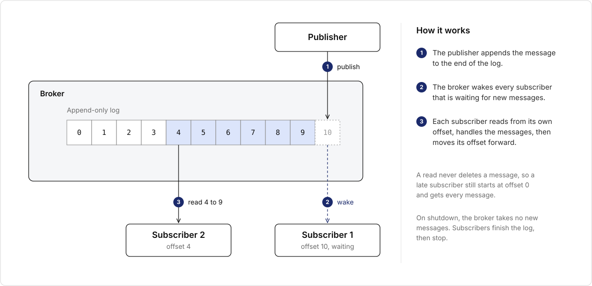

# appendix

An in-memory publish-subscribe broker in Go, built on an append-only log.

```sh
go run ./cmd/demo
go test -race ./...
go test -fuzz=FuzzInterleaving ./broker
```

Requires Go 1.25 or later.



- The broker keeps every message in one append-only log. A read never removes a message.
- Each subscriber owns its offset. A new subscriber starts at offset 0.
- Subscribers pull from the log. When a subscriber is caught up, it waits for the next publish.
- Handlers run outside the lock. A slow subscriber never blocks a publisher or another subscriber.
